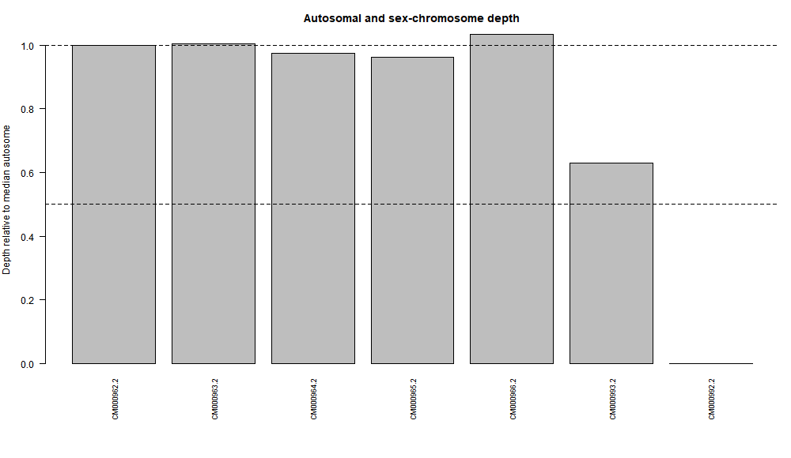

# Sex-Chromosome Dosage Analysis in Turkey (*Meleagris gallopavo*)

**Course:** Cell and Molecular Biology  
**Activity:** Sex-Chromosome Dosage in a Selected Animal Nuclear Genome Using NCBI, Galaxy, and R  
**Species:** Turkey (*Meleagris gallopavo*)  
**Genome Assembly:** Turkey_5.1 (GCA_000146605.4)  
**WGS Run:** SRR453555  

---

## 1. Project Overview

This project estimates the sex-chromosome complement of a turkey individual using whole-genome sequencing (WGS) read-depth analysis.

The analysis uses a chromosome-level reference genome from NCBI, read mapping and coverage estimation in Galaxy, and statistical analysis and visualization in R.

The main approach is to compare the sequencing depth of the Z chromosome with the median sequencing depth of selected autosomes. The W chromosome is also examined as additional evidence.

### Study Question

Does the sequencing read-depth pattern of the selected turkey WGS sample support a ZZ-like or ZW-like sex-chromosome complement, and does this agree with the sex recorded in its BioSample metadata?

## 2. Species and Sex-Chromosome System

The selected species is the turkey (*Meleagris gallopavo*).

Birds generally have a ZZ/ZW sex-determination system:
- Males normally have ZZ chromosomes.
- Females normally have ZW chromosomes.

The chromosome-level reference assembly identifies the Z chromosome as Chr41 and the W chromosome as Chr40.

**Reference:** [Sex chromosome coverage review](https://pmc.ncbi.nlm.nih.gov/articles/PMC6900093/)

## 3. NCBI Data Sources

### Reference Genome

- Species: *Meleagris gallopavo*
- Assembly name: Turkey_5.1
- Assembly accession: GCA_000146605.4
- Assembly BioSample: SAMN02981253
- Assembly level: Chromosome

Links:
- [NCBI Genome Assembly](https://www.ncbi.nlm.nih.gov/datasets/genome/GCA_000146605.4/)
- [NCBI Assembly Report](https://ftp.ncbi.nlm.nih.gov/genomes/all/GCA/000/146/605/GCA_000146605.4_Turkey_5.1/GCA_000146605.4_Turkey_5.1_assembly_report.txt)

### Whole-Genome Sequencing Reads

- WGS run: SRR453555
- WGS BioSample: SAMN00849324
- Recorded sex: Male

Links:
- [NCBI SRA Run SRR453555](https://www.ncbi.nlm.nih.gov/sra/SRR453555)
- [WGS BioSample SAMN00849324](https://www.ncbi.nlm.nih.gov/biosample/SAMN00849324)
- [Assembly BioSample SAMN02981253](https://www.ncbi.nlm.nih.gov/biosample/SAMN02981253)

**Important:** The assembly BioSample and WGS BioSample are different. Therefore, the sequencing-based inference refers to the WGS individual, not necessarily the individual used to produce the reference assembly.

## 4. Galaxy Workflow and Read Mapping

Galaxy was used to process the sequencing reads and calculate chromosome coverage.

### Procedure

1. Created a Galaxy history named `Sex_Dosage_Meleagris_gallopavo`.
2. Imported the Turkey_5.1 reference genome FASTA. 

3. Imported the WGS reads associated with SRR453555. 

4. Performed FastQC to examine read quality. 

5. Used BWA-MEM to align the reads against the same Turkey_5.1 reference assembly. 

6. The mapped reads were coordinate-sorted, and the BAM index was generated to support chromosome coverage analysis.
7. Used Samtools coverage to calculate chromosome coverage. 
8. Set minimum mapping quality to 20 and minimum base quality to 20. 

9. Downloaded the tabular coverage output and saved it as `chromosome_coverage.tsv`. 

### Galaxy Workflow and History

- [View Published Galaxy Workflow](https://usegalaxy.org/published/workflow?id=5be608fce25aa647)
- [Open Galaxy Analysis History](https://usegalaxy.org/u/shahantabalanza/h/sex-dosage-meleagris-gallopavo)
- [View Workflow Screenshot and Documentation](workflow/README.md)

## 5. Chromosome Identification and Grouping

Chromosome identifiers were verified using the NCBI assembly report.

Five autosomes were selected, together with the identified Z and W chromosomes.

| Reference sequence | Group |
|---|---|
| CM000962.2 | A |
| CM000963.2 | A |
| CM000964.2 | A |
| CM000965.2 | A |
| CM000966.2 | A |
| CM000993.2 | Z |
| CM000992.2 | W |

The five autosomes were used to calculate the median autosomal depth. The Z chromosome was used to calculate the Z:A ratio, while the W chromosome was included as additional evidence.

The chromosome labels were saved in `chromosome_groups.csv`.

## 6. R Analysis

The R analysis used the Samtools coverage output and the chromosome grouping file.

The script calculates:

- Median autosomal sequencing depth
- Relative chromosome depth
- Z:A ratio
- W:A ratio
- Preliminary dosage interpretation

It also generates a CSV file, a bar graph, and a text summary.

### Files

- [Complete R Script](sex_depth_analysis.R)
- [Input Coverage Table](chromosome_coverage.tsv)
- [Chromosome Grouping File](chromosome_groups.csv)

### Complete R Code

```r
# Sex-chromosome dosage from whole-genome DNA read depth
# Input: Samtools coverage TSV + student chromosome labels

cov <- read.delim("chromosome_coverage.tsv", comment.char = "",
                  check.names = FALSE, stringsAsFactors = FALSE)

names(cov)[1] <- "rname" # Accepts the '#rname' header

if (!"meandepth" %in% names(cov)) stop("Missing meandepth column")

key <- read.csv("chromosome_groups.csv", stringsAsFactors = FALSE)

if (!all(c("rname", "group") %in% names(key))) stop("Bad key columns")

key$rname <- trimws(key$rname)
key$group <- toupper(trimws(key$group))

if (anyDuplicated(key$rname)) stop("Repeated rname in key file")

if (!all(key$group %in% c("A", "X", "Y", "Z", "W")))
  stop("Use only A, X, Y, Z or W in the group column")

x <- merge(key, cov[, c("rname", "meandepth")],
           by = "rname", all.x = TRUE, sort = FALSE)

x$meandepth <- suppressWarnings(as.numeric(x$meandepth))

if (anyNA(x$meandepth)) stop("Missing depths: check rname matches")
if (any(x$meandepth < 0)) stop("Negative depth is not valid")
if (sum(x$group == "A") < 5) stop("Label at least 5 autosomes")

if ("X" %in% x$group && "Z" %in% x$group)
  stop("Choose either an XY or a ZW species, not both")

if (sum(x$group == "X") == 1 && !any(x$group == "Z")) {
  target <- "X"
  one_copy <- "XY-like"
  two_copies <- "XX-like"
} else if (sum(x$group == "Z") == 1 && !any(x$group == "X")) {
  target <- "Z"
  one_copy <- "ZW-like"
  two_copies <- "ZZ-like"
} else stop("Label exactly one X or exactly one Z chromosome")

A <- median(x$meandepth[x$group == "A"])

if (!is.finite(A) || A <= 0) stop("No usable autosomal coverage")

x$relative_depth <- x$meandepth / A

ratio <- x$relative_depth[x$group == target]

call <- if (ratio >= 0.80) two_copies else if (ratio <= 0.65)
  one_copy else "Ambiguous"

if (A < 1) call <- "Inconclusive: very low autosomal depth"

# Additional Y or W evidence can support, but not prove, a call
partner <- if (target == "X") "Y" else "W"

partner_ratio <- if (partner %in% x$group)
  x$relative_depth[x$group == partner][1] else NA_real_

# Export results and a simple, reproducible figure
dir.create("results", showWarnings = FALSE)

write.csv(x, "results/chromosome_relative_depth.csv",
          row.names = FALSE)

png("results/chromosome_depth.png", width = 1000, height = 580)

par(mar = c(8, 4, 3, 1))

barplot(x$relative_depth, names.arg = x$rname, las = 2,
        ylab = "Depth relative to median autosome",
        main = "Autosomal and sex-chromosome depth",
        cex.names = 0.75)

abline(h = c(0.5, 1.0), lty = 2)

dev.off()

summary <- c(
  paste("Median autosome depth:", round(A, 3)),
  paste(target, "/ A ratio:", round(ratio, 3)),
  paste(partner, "/ A ratio:", round(partner_ratio, 3)),
  paste("Dosage interpretation:", call),
  "Compare with BioSample sex and discuss limitations."
)

writeLines(summary, "results/sex_inference.txt")

cat(paste(summary, collapse = "\n"), "\n")
```

## 7. Results

The analysis used five selected autosomes and the Z and W chromosomes.

### Selected Chromosome Coverage Values

| Chromosome | Mean Depth |
|---|---:|
| CM000962.2 | 4.63416 |
| CM000963.2 | 4.65486 |
| CM000964.2 | 4.51520 |
| CM000965.2 | 4.45830 |
| CM000966.2 | 4.79467 |
| Z (CM000993.2) | 2.92286 |
| W (CM000992.2) | 0.00000 |

### Calculated Results

| Measurement | Result |
|---|---:|
| Median Autosomal Depth | 4.634 |
| Z:A Ratio | 0.631 |
| W:A Ratio | 0.000 |
| R Script Interpretation | ZW-like |

### Chromosome Relative Depth Graph


***Figure 1. Autosomal and sex-chromosome relative sequencing depth of *Meleagris gallopavo.**** 
Relative chromosome depth was calculated by dividing the mean sequencing depth of each chromosome by the median sequencing depth of five selected autosomes. The autosomes show relative depths near 1.0, while the Z chromosome (CM000993.2) has a relative depth of 0.631 and the W chromosome (CM000992.2) has no detected coverage. The Z:A ratio suggests a ZW-like dosage pattern based on the classroom thresholds, although this result conflicts with the recorded male sex of the WGS sample.

### Generated Output Files

- [Chromosome Relative Depth CSV](results/chromosome_relative_depth.csv)
- [Chromosome Depth Graph](results/chromosome_depth.png)
- [Sex Inference Summary](results/sex_inference.txt)

## 8. Answers to the Report Questions

### 1. What species did you choose, and what evidence supports a diploid XX/XY or ZZ/ZW system?

The selected species was the turkey (*Meleagris gallopavo*). It belongs to the class Aves, which generally follows a ZZ/ZW sex-chromosome system. Males normally have ZZ chromosomes, while females normally have ZW chromosomes. The NCBI chromosome-level assembly identifies the Z and W chromosomes.

### 2. What are your assembly accession, WGS run, and both BioSample accessions? Are the donors the same?

The reference genome used was Turkey_5.1, with assembly accession GCA_000146605.4 and assembly BioSample SAMN02981253. The WGS run was SRR453555, with BioSample SAMN00849324.

The two BioSample accessions are different, indicating that the assembly and WGS data came from different individuals. Therefore, the read-depth inference applies to the WGS donor.

### 3. Which sequences were used as autosomes and as X or Z? How did you verify their identities?

Five autosomes were selected: CM000962.2, CM000963.2, CM000964.2, CM000965.2, and CM000966.2.

The Z chromosome was CM000993.2, while the W chromosome was CM000992.2.

Their identities were verified using the NCBI assembly report, which identifies the chromosome assignments and corresponding GenBank accessions.

### 4. What are the median autosomal depth, Z:A ratio, and inferred sex-chromosome complement?

The median autosomal depth was 4.634×. The calculated Z:A ratio was 0.631, while the W:A ratio was 0.000.

Based on the classroom R script, the Z:A ratio falls within the ZW-like interpretation category. However, this is a preliminary interpretation and not a definitive sex-chromosome determination.

### 5. Does your result agree with the recorded sex of the WGS donor? Explain any discrepancy or uncertainty.

The WGS BioSample metadata records the individual as male. In a typical turkey ZZ/ZW system, a male is expected to have ZZ chromosomes.

However, the calculated Z:A ratio of 0.631 was classified as ZW-like by the classroom script. This does not agree with the recorded male sex.

The discrepancy may be associated with the relatively low sequencing depth, mapping bias, repetitive sequences, or other limitations affecting read-depth estimates. The absence of detected W coverage does not prove that the W chromosome is absent.

Therefore, the result should be considered uncertain and inconclusive rather than a definitive sex determination.

### 6. Why is a chromosome-level assembly alone insufficient for a reliable read-depth sex inference?

A chromosome-level genome assembly provides reference sequences and chromosome identities, but it does not show the sequencing depth of a particular individual.

Sex-chromosome dosage inference requires whole-genome DNA reads from the individual to be aligned against the reference genome. The resulting chromosome coverage values are then compared to autosomal coverage to estimate relative dosage.

Therefore, chromosome lengths or the reference FASTA alone cannot establish the sex-chromosome complement of the WGS individual.

## 9. Limitations

Several limitations should be considered when interpreting the results:

1. The median autosomal depth was relatively low at 4.634×, which may affect the reliability of coverage estimates.
2. Mapping bias and repetitive genomic regions may influence read alignment and chromosome coverage.
3. The assembly and WGS data came from different individuals.
4. The W chromosome had zero detected mean depth, but this does not independently prove its absence.
5. The classroom thresholds are teaching guidelines and should not be treated as diagnostic standards.
6. The Z:A ratio and W:A ratio should be interpreted together with sequencing quality and sample metadata.

Overall, the results provide a preliminary read-depth estimate, but the discrepancy with the recorded male sex means that a definitive sex-chromosome complement cannot be established from this analysis alone.

## 10. References

- National Center for Biotechnology Information (NCBI). Turkey_5.1 genome assembly, GCA_000146605.4. https://www.ncbi.nlm.nih.gov/datasets/genome/GCA_000146605.4/
- National Center for Biotechnology Information (NCBI). Sequence Read Archive, SRR453555. https://www.ncbi.nlm.nih.gov/sra/SRR453555
- Galaxy Project. Galaxy NGS Data Management Tutorial. https://training.galaxyproject.org/training-material/topics/introduction/tutorials/galaxy-intro-ngs-data-management/tutorial.html
- Samtools. Samtools Coverage Documentation. https://www.htslib.org/doc/samtools-coverage.html
- National Center for Biotechnology Information (NCBI). Sex chromosome coverage review. https://pmc.ncbi.nlm.nih.gov/articles/PMC6900093/
